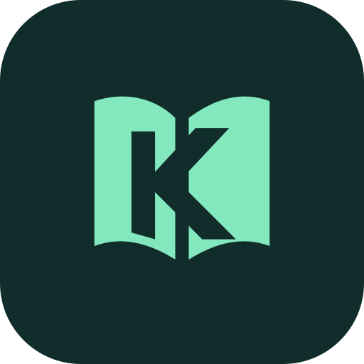
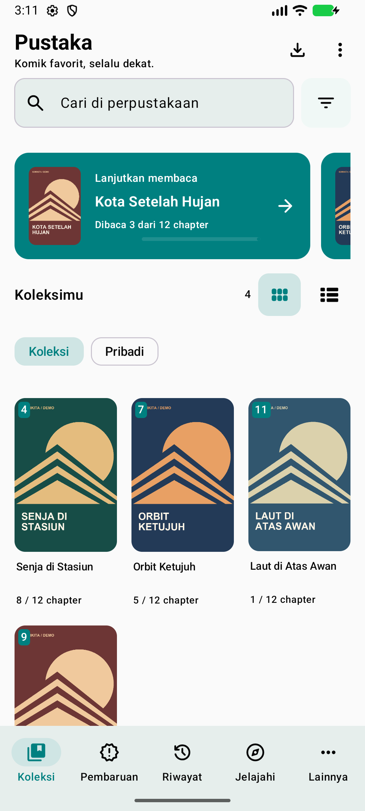
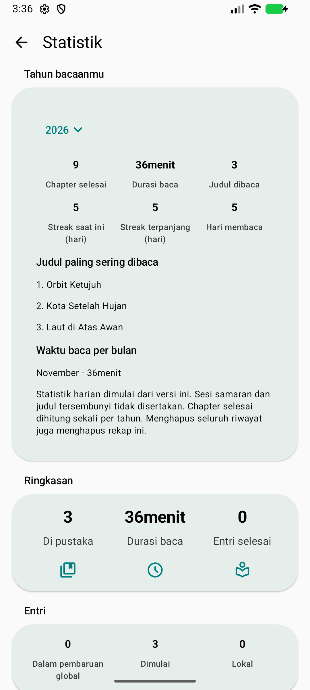
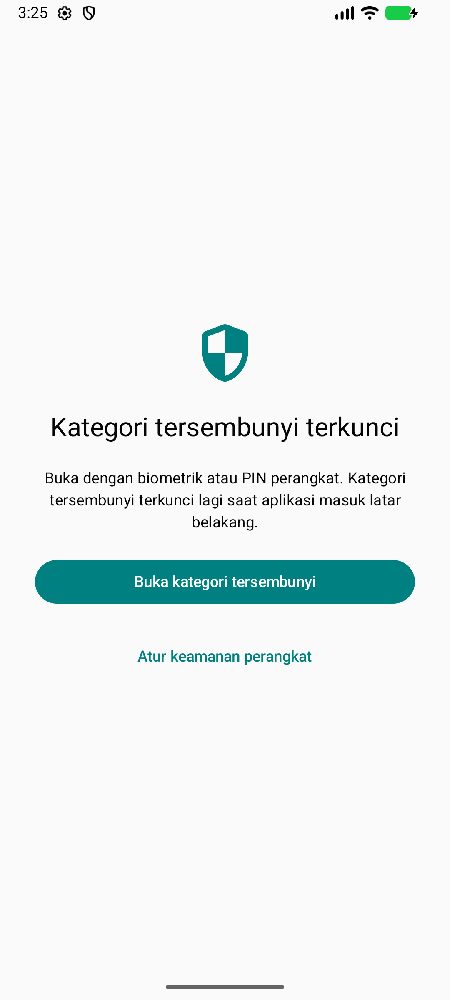

[English](README.md) | **Bahasa Indonesia**

<div align="center">



# KomiKita

KomiKita adalah aplikasi Android bersumber terbuka untuk membaca manga, komik, dan webtoon. Kamu bisa mengatur koleksi, mengunduh chapter untuk dibaca offline, dan melanjutkan bacaan terakhir.

[](https://github.com/BaghasWahyu/komikita/releases/latest)
[](#unduh-dan-instal)
[](https://github.com/BaghasWahyu/komikita/actions/workflows/build.yml)
[](LICENSE)

[**Unduh rilis terbaru**](https://github.com/BaghasWahyu/komikita/releases/latest) · [Panduan penggunaan](docs/id/USER_GUIDE.md) · [Changelog](CHANGELOG.id.md) · [Laporkan masalah](https://github.com/BaghasWahyu/komikita/issues)

</div>

<p align="center">
  
  
  
</p>

Screenshot aplikasi asli dengan judul demo orisinal. [Cara membuat ulang demo](tools/demo/README.md).

KomiKita berawal dari [Mihon](https://github.com/mihonapp/mihon), penerus basis kode Tachiyomi. Fork ini menambahkan pengaturan visibilitas perpustakaan, kartu Lanjutkan Membaca, dan pembaruan dari dalam aplikasi. KomiKita punya ID aplikasi sendiri dan bisa dipasang berdampingan dengan Mihon.

## Daftar isi

- [Fitur](#fitur)
- [Unduh dan instal](#unduh-dan-instal)
- [Mulai menggunakan](#mulai-menggunakan)
- [Pembaruan aplikasi](#pembaruan-aplikasi)
- [Berpindah dari Mihon](#berpindah-dari-mihon)
- [Privasi dan sumber konten](#privasi-dan-sumber-konten)
- [Build dari source](#build-dari-source)
- [Struktur proyek](#struktur-proyek)
- [Dokumentasi](#dokumentasi)
- [Kontribusi dan dukungan](#kontribusi-dan-dukungan)
- [Kredit dan lisensi](#kredit-dan-lisensi)

## Fitur

| Fitur | Cara kerjanya |
| --- | --- |
| Pembaca | Pilih mode halaman atau webtoon. Arah baca, tema, dan kontrol bisa diatur dari pembaca. |
| Perpustakaan | Buat kategori, cari dan filter judul, lalu pilih tampilan grid atau daftar. |
| Lanjutkan Membaca | Geser hingga lima rekomendasi: bacaan terakhir, bacaan lain yang baru dibuka, atau komik dengan chapter baru. Notifikasi chapter baru juga memiliki tombol Lanjutkan membaca. |
| Bacaan offline dan lokal | Unduh chapter atau buka komik yang tersimpan di perangkat. |
| Privasi | Buka kategori tersembunyi dengan biometrik atau PIN, pola, atau sandi perangkat Android. Kategori terkunci lagi saat aplikasi masuk latar belakang. Judulnya tidak muncul di Lanjutkan membaca, riwayat, notifikasi pembaruan, dan widget. |
| Visibilitas | Di Jelajah, sembunyikan ekstensi dan sumbernya tanpa mencopot ekstensi. |
| Statistik membaca | Lihat chapter selesai, waktu baca, streak saat ini dan terpanjang, serta rekap tahunan berisi judul favorit dan waktu baca bulanan. |
| Log diagnostik | Ekspor log aplikasi terbaru dan detail perangkat dari pengaturan Lanjutan, dengan URL, kredensial, dan judul tersembunyi disamarkan. |
| Ikon ekstensi | Tampilkan ikon ekstensi pada komik di perpustakaan. |
| Progres membaca | Simpan riwayat dan progres, jadwalkan pembaruan perpustakaan, atau hubungkan layanan seperti AniList dan MyAnimeList. |
| Cadangan | Simpan cadangan perpustakaan, progres, dan pengaturan ke lokasi pilihan untuk dipulihkan nanti. |
| Hemat baterai | Saat membaca, aplikasi mengutamakan refresh rate layar hingga 60 Hz. Opsi ini bisa dimatikan. |
| Pembaruan aplikasi | Lihat catatan rilis dan unduh APK yang sesuai dari dalam aplikasi. |

Di versi `1.0.7`, KomiKita bisa memuat sampul dari sumber yang memberikan alamat gambar relatif, misalnya jalur yang diawali `/images/covers/`.

Cara mengatur visibilitas, ikon ekstensi, dan mode hemat baterai ada di [panduan penggunaan](docs/id/USER_GUIDE.md). Dampak pengaturan refresh rate pada baterai bergantung pada perangkat dan kondisi membaca. Hasil pengukurannya ada di [catatan performa](docs/id/PERFORMANCE.md).

## Unduh dan instal

KomiKita membutuhkan Android 8.0 (API 26) atau lebih baru. Unduh APK dari [GitHub Releases](https://github.com/BaghasWahyu/komikita/releases/latest).

### Pilih APK

Pilih APK universal jika kamu belum tahu arsitektur perangkatmu. `X.Y.Z` pada nama berkas adalah nomor versi.

| Nama APK | Penggunaan |
| --- | --- |
| `komikita-vX.Y.Z.apk` | Semua arsitektur yang tercantum di bawah. |
| `komikita-arm64-v8a-vX.Y.Z.apk` | Ponsel dan tablet ARM64. |
| `komikita-armeabi-v7a-vX.Y.Z.apk` | Perangkat dengan ARM 32-bit. |
| `komikita-x86-vX.Y.Z.apk` | Perangkat atau emulator x86 32-bit. |
| `komikita-x86_64-vX.Y.Z.apk` | Perangkat atau emulator x86 64-bit. |

Workflow rilis GitHub hanya menghasilkan APK standar (`app.komikita`). Fitur pembaruan aktif dan Firebase nonaktif secara bawaan. Android memasang APK standar sebagai aplikasi terpisah dari instalasi FOSS lama (`app.komikita.foss`), yang menyimpan datanya sendiri.

### Instal aplikasi

1. Unduh APK pilihanmu dari halaman rilis.
2. Buka berkas APK lewat browser atau pengelola berkas.
3. Saat Android meminta izin memasang dari aplikasi tersebut, beri izin lalu konfirmasi pemasangan.
4. Buka KomiKita dan selesaikan penyiapan awal.

Untuk memperbarui aplikasi dan mempertahankan data, pasang APK yang lebih baru dari varian yang sama di atas instalasi yang ada.

## Mulai menggunakan

1. Saat penyiapan, pilih folder khusus untuk unduhan, cadangan, dan berkas aplikasi lainnya.
2. Buka komik lokal atau siapkan repositori ekstensi yang kompatibel. KomiKita tidak menyertakan komik maupun sumber bawaan.
3. Tambahkan judul ke perpustakaan. Gunakan kategori, tampilan, dan filter untuk mengatur koleksi.
4. Atur mode, arah baca, dan kontrol di pembaca. Unduh chapter sebelum kamu perlu membaca offline.
5. Buat cadangan dari pengaturan data dan penyimpanan sebelum pindah perangkat atau mengubah instalasi.

## Pembaruan aplikasi

APK rilis GitHub memeriksa pembaruan saat aplikasi dibuka, lalu setiap enam jam selama aplikasi masih digunakan. Untuk memeriksa langsung, buka **Lainnya → Tentang → Periksa pembaruan**. Sejak versi `1.0.6`, pemeriksaan manual meminta data rilis baru dari GitHub.

KomiKita menawarkan pembaruan jika ada rilis stabil yang sudah dipublikasikan, versinya lebih tinggi, dan APK-nya kompatibel. Aplikasi menampilkan catatan rilis dan menawarkan unduhan. Android meminta konfirmasi saat pemasangan.

Jika aplikasi menampilkan **No new updates**, bandingkan versi di **Tentang** dengan [rilis GitHub terbaru](https://github.com/BaghasWahyu/komikita/releases/latest). Jika ada versi yang lebih baru, kamu bisa memasang APK dari varian yang sama secara manual. Pemeriksa pembaruan pada build lokal dan CI harus diaktifkan saat build.

Lihat [panduan pemeriksaan pembaruan](docs/id/USER_GUIDE.md#memeriksa-pembaruan-aplikasi).

## Berpindah dari Mihon

1. Buat cadangan di Mihon.
2. Instal KomiKita dan pilih folder penyimpanannya.
3. Buka pengaturan data dan penyimpanan KomiKita, lalu pulihkan cadangan.
4. Periksa perpustakaan dan progres membaca. Jika perlu, pasang kembali ekstensi dan masuk lagi ke layanan pelacakan.

Langkah pemulihan ada di [panduan migrasi](docs/id/USER_GUIDE.md#berpindah-dari-mihon). Lihat juga [identitas dan kompatibilitas proyek](docs/id/BRANDING.md).

## Privasi dan sumber konten

KomiKita menyimpan perpustakaan, progres membaca, preferensi, dan kredensial layanan pelacakan di perangkat. Kamu memilih lokasi cadangannya.

Build bawaan tidak menyertakan Firebase Analytics atau Crashlytics. Aplikasi mengirim permintaan ke sumber konten, ekstensi, layanan pelacakan, dan penyedia DNS sesuai fitur yang digunakan. APK rilis juga menghubungi GitHub untuk memeriksa dan mengunduh pembaruan.

Rincian penyimpanan data, permintaan jaringan, dan telemetri opsional ada di [kebijakan privasi](docs/id/PRIVACY.md).

## Build dari source

KomiKita menggunakan Kotlin, Jetpack Compose, SQLDelight, dan WorkManager. Modul Rust opsional memproses data chapter melalui JNI. Build tanpa modul itu memakai implementasi Kotlin.

### Persyaratan

| Tool | Konfigurasi proyek |
| --- | --- |
| Android Studio | Gunakan versi yang kompatibel dengan Android Gradle Plugin proyek. |
| JDK | CI dimulai dengan JDK 21 dari [`.github/.java-version`](.github/.java-version). [Kriteria daemon Gradle](gradle/gradle-daemon-jvm.properties) memilih JetBrains JDK 25; Gradle dapat menyediakan JVM daemon yang sesuai. Target bytecode Java adalah versi 17. |
| Android SDK | Compile SDK **37.2**, target SDK **36**, minimum SDK **26**. |
| Android NDK | **29.0.14206865** untuk build native. |
| Gradle | Gunakan wrapper yang disertakan; tidak perlu memasang Gradle secara terpisah. |
| Rust, opsional | Rust stable, target Android, dan `cargo-ndk` untuk build yang menyertakan modul native. |

[Katalog versi](gradle/mihon.versions.toml), [konfigurasi wrapper Gradle](gradle/wrapper/gradle-wrapper.properties), dan [workflow CI](.github/workflows/build.yml) menjadi acuan persyaratan build.

### Build debug tanpa modul native

```sh
git clone https://github.com/BaghasWahyu/komikita.git
cd komikita
```

Atur lokasi Android SDK melalui `ANDROID_HOME`, atau buat berkas `local.properties` yang tidak dilacak Git di direktori utama repositori.

```properties
sdk.dir=/absolute/path/to/Android/Sdk
```

Jalankan build debug dengan perintah berikut.

```sh
./gradlew assembleDebug -Penable-rust=false
```

Di Windows, ganti `./gradlew` dengan `.\gradlew.bat`. APK debug dihasilkan pada `app/build/outputs/apk/debug/` dan menggunakan ID aplikasi terpisah `app.komikita.dev`.

### Build dengan pemrosesan native

Pasang Rust, target Android, dan `cargo-ndk` sesuai [panduan modul native](docs/id/NATIVE.md). Lalu jalankan perintah berikut.

```sh
./gradlew assembleDebug
```

Untuk memakai NDK lain yang sudah terpasang, tambahkan `-Prust-ndk-path=/path/to/ndk`.

### Jalankan pemeriksaan

```sh
./gradlew spotlessCheck testDebugUnitTest verifySqlDelightMigration -Penable-rust=false
```

Untuk menyertakan modul native dalam pemeriksaan, hapus `-Penable-rust=false` setelah toolchain siap. Atur penandatanganan APK sebelum mendistribusikan rilis. Android memakai ID aplikasi dan kunci penandatanganan untuk mencocokkan pembaruan dengan instalasi yang ada. Rincian penandatanganan, varian rilis, terjemahan, dan catatan rilis ada di [panduan kontribusi](CONTRIBUTING.id.md).

## Struktur proyek

| Lokasi | Tanggung jawab |
| --- | --- |
| [`app/`](app) | UI Compose, pembaca, unduhan, tracker, cadangan, dan layanan aplikasi. |
| [`domain/`](domain) | Model, use case, dan kontrak repository. |
| [`data/`](data) | Akses database, implementasi repository, dan metadata rilis. |
| [`core/`](core) | Utilitas bersama, jaringan, arsip, dependency injection, dan penghubung JNI. |
| [`native/`](native) | Implementasi pemrosesan chapter dengan Rust. |
| [`source-api/`](source-api), [`source-local/`](source-local) | Kontrak ekstensi dan dukungan konten lokal. |
| [`presentation-core/`](presentation-core), [`presentation-widget/`](presentation-widget) | Komponen presentasi bersama dan widget. |
| [`i18n/`](i18n), [`icons/`](icons) | Terjemahan dan aset ikon. |

Lihat [struktur proyek dan alur data](docs/id/PROJECT_ANALYSIS.md) untuk gambaran arsitektur.

## Dokumentasi

| Panduan | Isi |
| --- | --- |
| [Panduan penggunaan](docs/id/USER_GUIDE.md) | Visibilitas perpustakaan, ikon ekstensi, hemat baterai, pembaruan, dan migrasi. |
| [Changelog](CHANGELOG.id.md) | Fitur dan perbaikan pada setiap versi. |
| [Kontribusi](CONTRIBUTING.id.md) | Persiapan pengembangan, signing, terjemahan, dan penyiapan rilis. |
| [Kebijakan privasi](docs/id/PRIVACY.md) | Data lokal, permintaan jaringan, dan telemetry. |
| [Modul native](docs/id/NATIVE.md) | Toolchain Rust, integrasi JNI, dan fallback Kotlin. |
| [Catatan performa](docs/id/PERFORMANCE.md) | Metode pengukuran, hasil, dan batas kesimpulannya. |
| [Catatan validasi](docs/id/VALIDATION.md) | Riwayat pemeriksaan build dan pengujian. |

[Indeks dokumentasi](docs/id/README.md) menautkan seluruh panduan proyek dalam **bahasa Inggris dan Bahasa Indonesia**.

## Kontribusi dan dukungan

Gunakan [GitHub Issues](https://github.com/BaghasWahyu/komikita/issues) untuk melaporkan bug atau mengusulkan perbaikan. Sertakan versi KomiKita, versi Android, varian APK, langkah reproduksi, dan log terkait yang telah dibersihkan dari informasi pribadi.

Kontribusi kode, dokumentasi, dan terjemahan diterima dalam bahasa Inggris maupun Bahasa Indonesia. Mulai dari [CONTRIBUTING.id.md](CONTRIBUTING.id.md) dan ikuti [Kode Etik](CODE_OF_CONDUCT.md).

## Kredit dan lisensi

KomiKita dibangun di atas [Mihon](https://github.com/mihonapp/mihon) dan Tachiyomi. Kredit diberikan kepada tim serta kontributornya; pemberitahuan hak cipta dan lisensi upstream dipertahankan. Lihat [Kredit dan Penghargaan](CREDITS.id.md) serta [changelog upstream](docs/UPSTREAM_CHANGELOG.md).

Copyright © 2015 Javier Tomás<br />
Copyright © 2024 Mihon Open Source Project

Dilisensikan di bawah [Apache License 2.0](LICENSE). KomiKita tidak menghosting konten dan tidak berafiliasi dengan penyedia konten.
