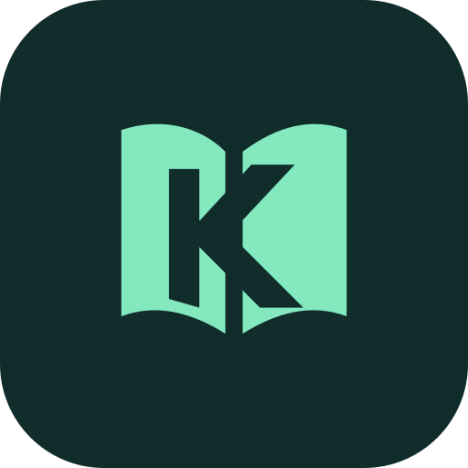

**English** | [Bahasa Indonesia](README.id.md)

<div align="center">


# KomiKita

**Your comics, always close.** · Version 1.0.1

An open-source manga, comic, and webtoon reader for Android 8.0 and later.

[Downloads](https://github.com/BaghasWahyu/komikita/releases) · [Report an issue](https://github.com/BaghasWahyu/komikita/issues) · [Contribute](CONTRIBUTING.md)
</div>

## Features

- Customizable page and webtoon readers with reading direction, themes, and controls.
- A library with categories, search, filters, local comics, and chapter downloads for offline reading.
- Hide categories and their comics, and show them again through category management.
- Hide extensions and their sources from Browse without uninstalling them.
- Optional extension icon badges on comics in your library.
- Reading progress tracking, scheduled library updates, backup, and restore.
- A reader battery saver setting that requests a display refresh rate of up to 60 Hz.

See the [user guide](docs/USER_GUIDE.md) for hidden categories, hidden extensions, extension icons, and the battery saver setting. The [documentation index](docs/README.md) links to English and Indonesian versions of every project guide.

## Installation

1. Download an APK from [KomiKita Releases](https://github.com/BaghasWahyu/komikita/releases). Choose the APK for your device's architecture, or the universal APK if you are unsure.
2. Install it on a device running **Android 8.0 (API 26) or later**, allowing installation from your browser or file manager when Android prompts you.

KomiKita has its own application ID, `app.komikita`, and can be installed alongside Mihon. To move your library, create a backup in Mihon and restore it through KomiKita's data and storage settings. Extensions and service logins may need to be set up again. See [Moving from Mihon](docs/USER_GUIDE.md#moving-from-mihon).

## Development

KomiKita uses Kotlin, Jetpack Compose, SQLDelight, and WorkManager. An optional Rust module accessed through JNI calculates missing chapters, with a Kotlin fallback.

### Requirements

- Android Studio and **JDK 21**, matching [CI](.github/.java-version). The project targets Java 17 bytecode.
- The Android SDK and NDK versions defined in [the version catalog](gradle/mihon.versions.toml): compile SDK **37.2** and NDK **29.0.14206865**.
- For native builds, stable Rust, Android targets, and cargo-ndk. Follow the [native module guide](docs/NATIVE.md) to install the toolchain.

### Build and checks

Clone the repository, then configure the Android SDK through `sdk.dir` in `local.properties` or the `ANDROID_HOME` environment variable.

```sh
git clone https://github.com/BaghasWahyu/komikita.git
cd komikita
./gradlew assembleDebug
```

On Windows, replace `./gradlew` with `.\gradlew.bat`. Debug APKs are written to `app/build/outputs/apk/debug/`.

To build without the Rust toolchain, use the Kotlin fallback:

```sh
./gradlew assembleDebug -Penable-rust=false
```

Run the project's formatting, unit test, and database migration checks:

```sh
./gradlew spotlessCheck testDebugUnitTest verifySqlDelightMigration
```

Add `-Penable-rust=false` to the checks above if the native toolchain is not installed. See the [contributor guide](CONTRIBUTING.md) for signing, build variants, translations, and release configuration.

## Documentation

| Guide | What it covers |
| --- | --- |
| [User guide](docs/USER_GUIDE.md) | Hidden categories and extensions, library icons, battery saver, and migration |
| [Changelog](CHANGELOG.md) | Changes made in KomiKita |
| [Project structure](docs/PROJECT_ANALYSIS.md) | Modules, architecture, and data flow |
| [Native module](docs/NATIVE.md) | Toolchain setup and the Kotlin fallback |
| [Performance notes](docs/PERFORMANCE.md) | Performance and battery measurement details |
| [Project identity](docs/BRANDING.md) | Branding and compatibility with the upstream codebase |

Browse the [documentation index](docs/README.md) for all guides in English and Bahasa Indonesia. Report bugs or suggest features through [KomiKita Issues](https://github.com/BaghasWahyu/komikita/issues); contributions are welcome in either language.

## Privacy and distribution

Default builds do not include Firebase Analytics or Crashlytics, and the built-in app updater is disabled by default. Releases are distributed through the [KomiKita repository](https://github.com/BaghasWahyu/komikita/releases). See the [privacy policy](docs/PRIVACY.md) for local storage, backups, and requests to external services.

## Origins and license

KomiKita is a fork of [Mihon](https://github.com/mihonapp/mihon), which continues the Tachiyomi codebase. Full credit goes to the Mihon team and all Tachiyomi contributors; see [Credits and acknowledgements](CREDITS.md). Upstream copyright notices are retained. Changes made before the fork are recorded in the [upstream changelog](docs/UPSTREAM_CHANGELOG.md).

Copyright © 2015 Javier Tomás
Copyright © 2024 Mihon Open Source Project

Licensed under the [Apache License 2.0](LICENSE). KomiKita does not host content and is not affiliated with content providers.
